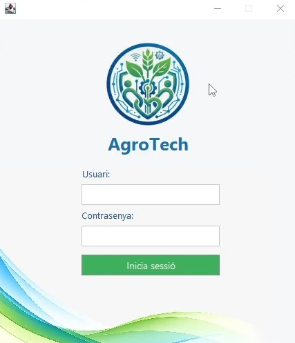
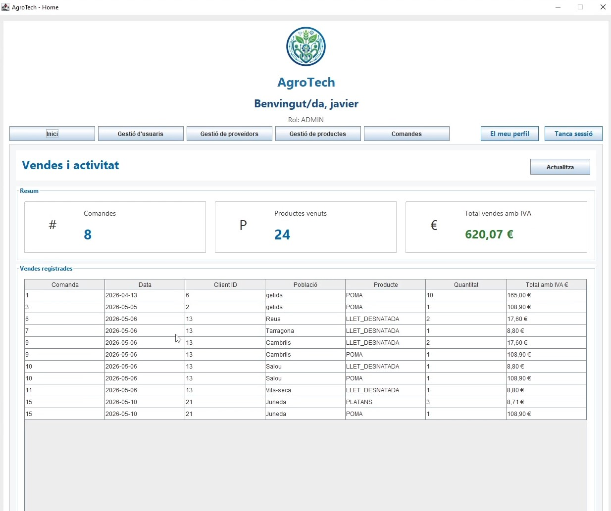
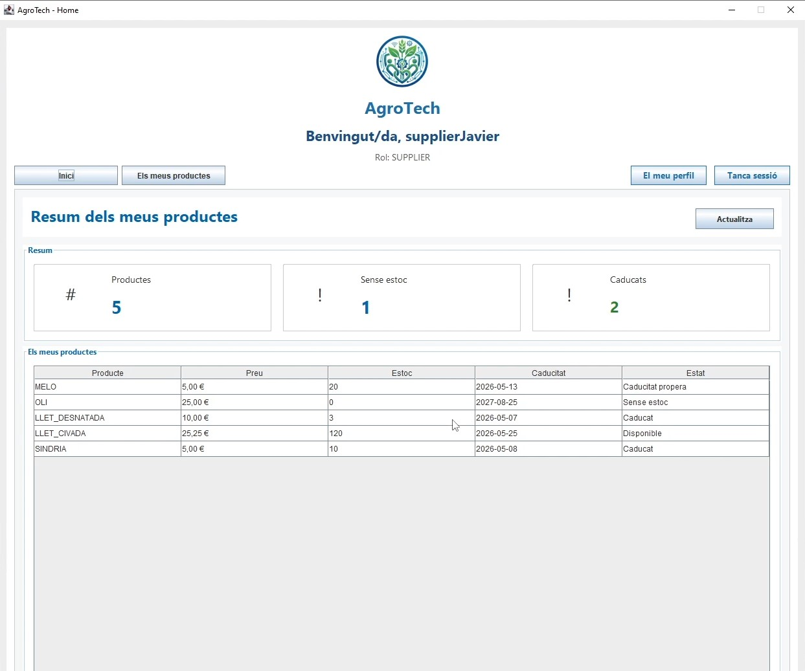
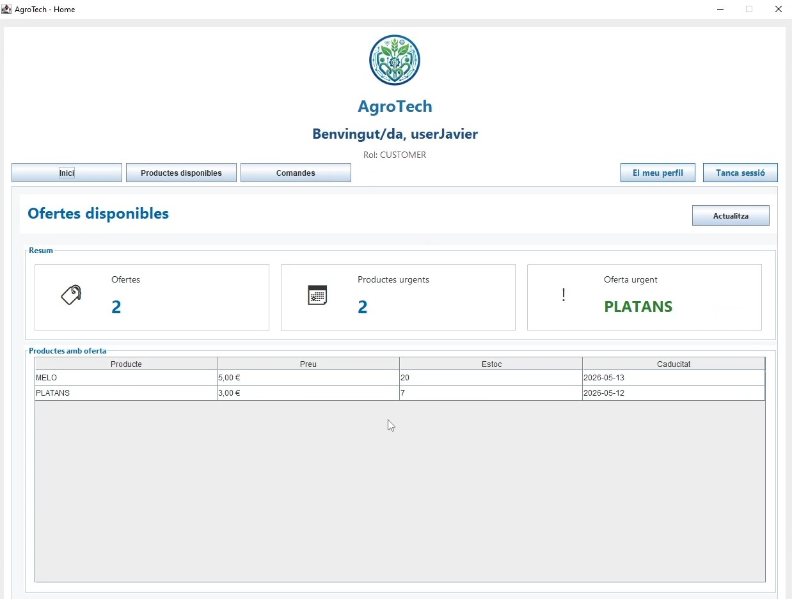
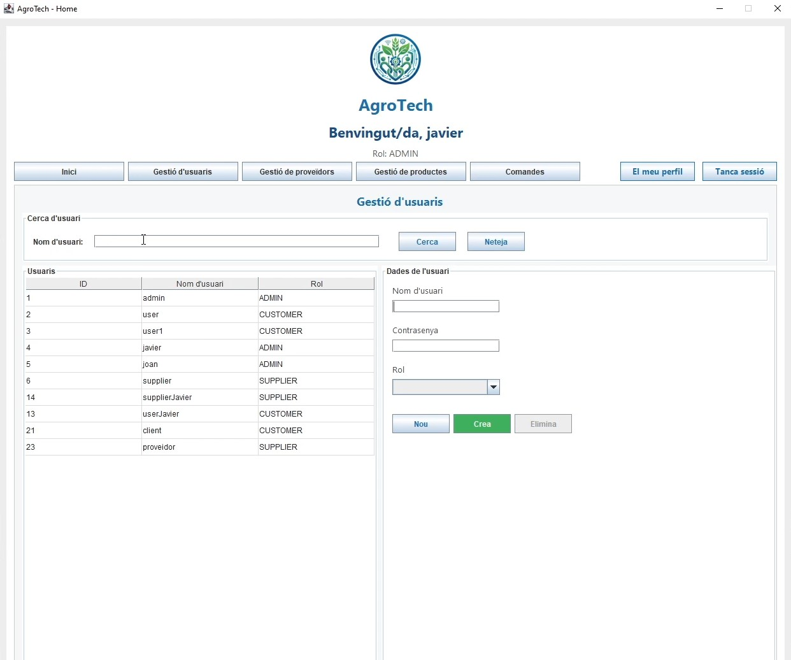
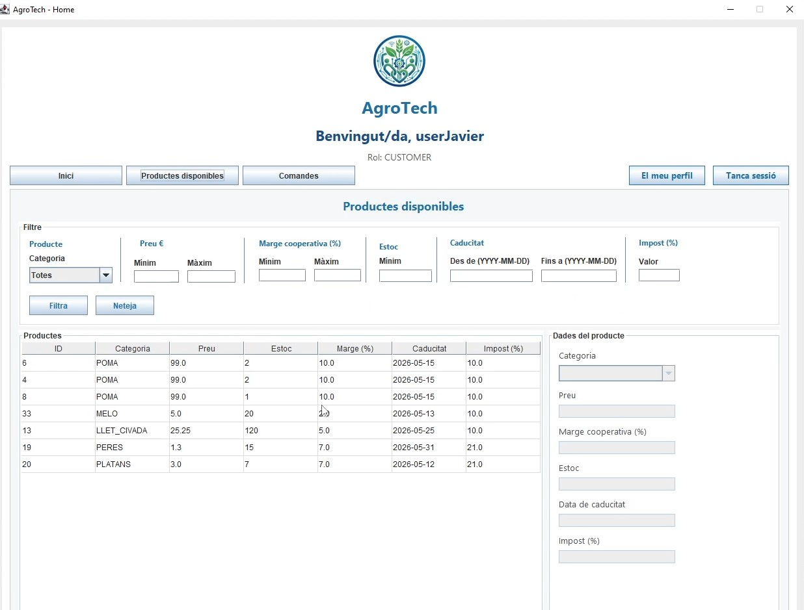
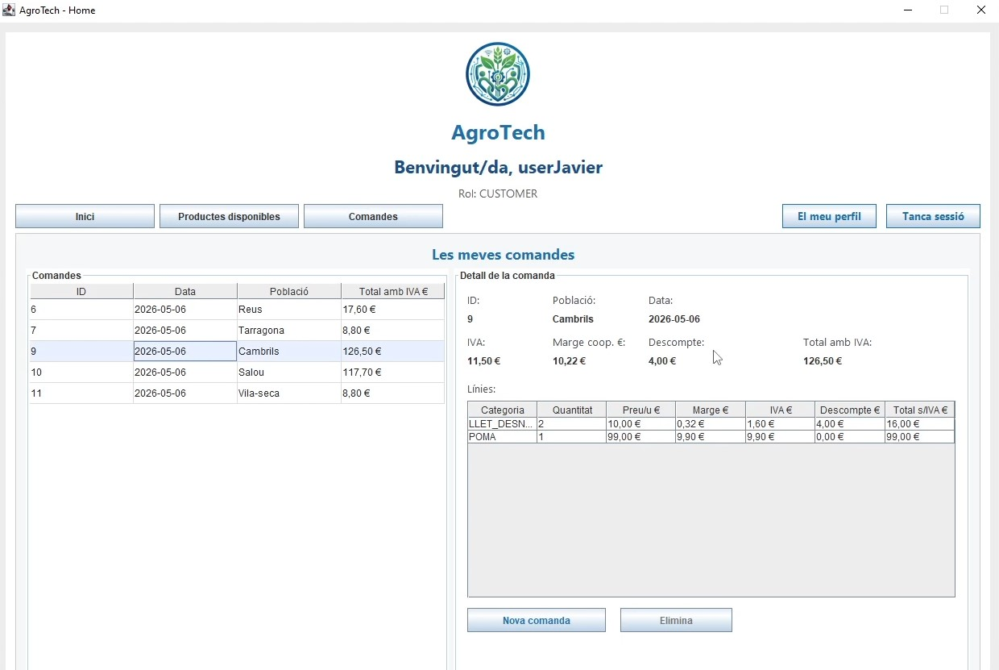
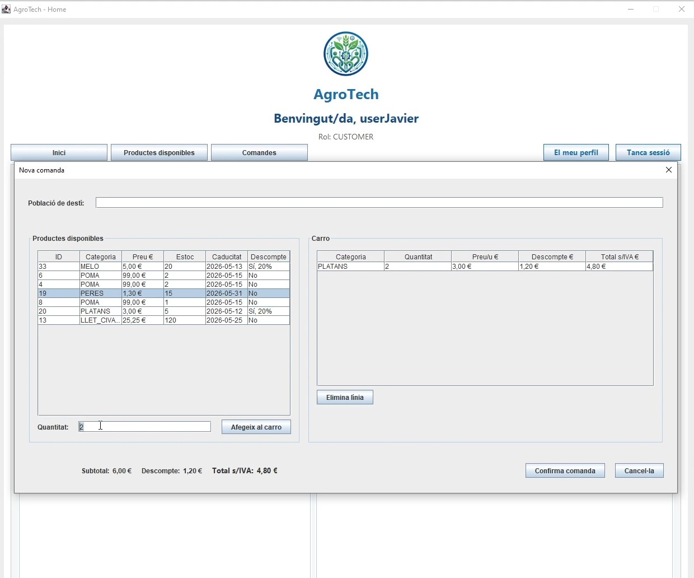

# AgroTech — Aplicación de escritorio en Java

**Proyecto final del Ciclo Formativo de Grado Superior en Desarrollo de Aplicaciones Multiplataforma (DAM).**

AgroTech es una aplicación de gestión de productos agroalimentarios desarrollada como proyecto académico colaborativo. Su objetivo es facilitar la gestión de productos, proveedores, usuarios y pedidos, incorporando funcionalidades relacionadas con el control de existencias y las fechas de caducidad.

El proyecto completo se desarrolló en un equipo de cuatro estudiantes e incluye un backend, una aplicación Android y un cliente de escritorio.

**Este repositorio corresponde al cliente de escritorio, desarrollado principalmente por Javier Santana Coronado.**

## Tecnologías utilizadas

| Tecnología | Aplicación |
|---|---|
| Java | Desarrollo del cliente de escritorio |
| Java Swing | Interfaces gráficas y formularios |
| Apache NetBeans | Entorno de desarrollo |
| Retrofit y OkHttp | Comunicación con la API REST |
| Gson | Conversión de datos JSON |
| JUnit 4 | Pruebas unitarias y de integración |
| HTTPS y tokens de autenticación | Comunicación y gestión de sesiones |
| Git y GitHub | Control de versiones y colaboración |

## Capturas de la aplicación

### Inicio de sesión y panel de administración

| Autenticación | Dashboard de administrador |
|---|---|
|  |  |

### Paneles según el rol

| Proveedor | Cliente |
|---|---|
|  |  |

### Gestión de usuarios y productos

| Administración de usuarios | Catálogo de productos |
|---|---|
|  |  |

### Gestión de pedidos

| Consulta de pedidos | Creación de pedidos |
|---|---|
|  |  |

## Funcionalidades principales

La aplicación dispone de tres roles con diferentes permisos y funcionalidades.

### Administrador (ADMIN)

- Gestión de usuarios: creación, consulta, modificación y eliminación.
- Administración de proveedores y productos.
- Consulta y gestión de pedidos.
- Dashboard con resumen de ventas y actividad.
- Acceso a información mediante formularios y tablas.

### Proveedor (SUPPLIER)

- Consulta y gestión de productos propios.
- Seguimiento de existencias.
- Identificación de productos agotados o caducados.
- Dashboard con información de los productos.
- Gestión de información del perfil.

### Cliente (CUSTOMER)

- Consulta del catálogo de productos disponibles.
- Búsqueda y filtrado de productos.
- Visualización de ofertas relacionadas con fechas de caducidad próximas.
- Creación de pedidos mediante carrito de compra.
- Cálculo de importes y descuentos.
- Consulta de pedidos y sus detalles.

### Autenticación y sesiones

- Inicio y cierre de sesión.
- Gestión del usuario autenticado.
- Comunicación con los servicios de autenticación del backend.
- Incorporación automática del token a las peticiones HTTP protegidas.
- Interfaz adaptada al rol del usuario.

## Arquitectura del cliente

El código se organiza en paquetes que separan las responsabilidades de la aplicación.

```text
src/agrotech/
├── client/       # Comunicación con la API REST
│   └── retrofit/ # Interfaces HTTP y configuración
├── dto/          # Objetos de transferencia de datos
├── main/         # Punto de entrada
├── model/        # Modelos de la aplicación
├── resources/    # Recursos gráficos
├── service/      # Lógica de aplicación y validaciones
├── session/      # Gestión de sesiones
└── view/         # Interfaces Swing
    ├── components/
    └── panels/
```

La separación entre presentación, servicios y comunicación HTTP facilita la organización del proyecto y permite desarrollar y probar diferentes funcionalidades de forma independiente.

## Pruebas

El repositorio incluye pruebas unitarias y pruebas de integración desarrolladas con JUnit 4.

Entre las funcionalidades cubiertas se encuentran:

- Validación del inicio de sesión.
- Gestión de sesiones.
- Comunicación HTTP y autenticación.
- Operaciones sobre usuarios, proveedores, productos y pedidos.
- Filtrado de productos y pedidos.
- Validaciones de lógica de aplicación.

Las pruebas de integración requieren la disponibilidad del backend y de datos de prueba apropiados.

## Mi contribución al proyecto

**Javier Santana Coronado — Desarrollo del cliente de escritorio**

Mi principal responsabilidad dentro del equipo fue desarrollar la aplicación de escritorio utilizando Java y Swing.

Entre las áreas de trabajo destacan:

- Diseño e implementación de interfaces y formularios.
- Organización del código en diferentes capas.
- Integración con los endpoints de la API REST.
- Implementación de operaciones de gestión de datos.
- Gestión de autenticación, sesiones y permisos por rol.
- Tratamiento de respuestas del servidor y validaciones.
- Desarrollo de pruebas unitarias y de integración.

Este proyecto me permitió aplicar de forma práctica conocimientos de programación orientada a objetos, desarrollo de interfaces, comunicación cliente-servidor y trabajo colaborativo con Git.

## Requisitos y ejecución

El proyecto se desarrolló con Apache NetBeans utilizando Java y bibliotecas externas incluidas en el repositorio.

La configuración actual del proyecto indica Java 25 como versión de compilación.

Para utilizar las funcionalidades conectadas al servidor es necesario disponer del backend correspondiente y configurar adecuadamente su URL y la conexión HTTPS.

## Estado del proyecto

**Proyecto académico finalizado y evaluado.**

AgroTech se desarrolló como trabajo final del módulo de Proyecto de DAM (M13).

El servidor utilizado durante el desarrollo ya no está activo. El código se conserva con fines de portfolio y demostración de conocimientos técnicos.

La aplicación no se mantiene actualmente como producto en producción.

---

*Proyecto académico realizado en equipo de cuatro estudiantes del CFGS de Desarrollo de Aplicaciones Multiplataforma.*
